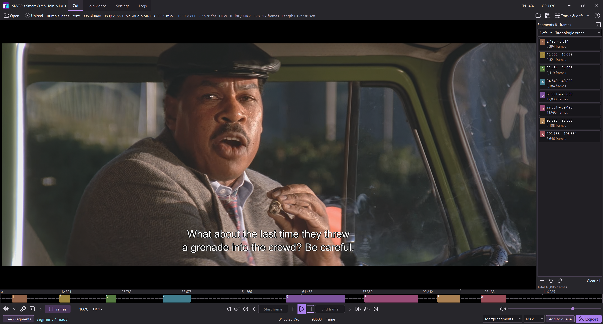
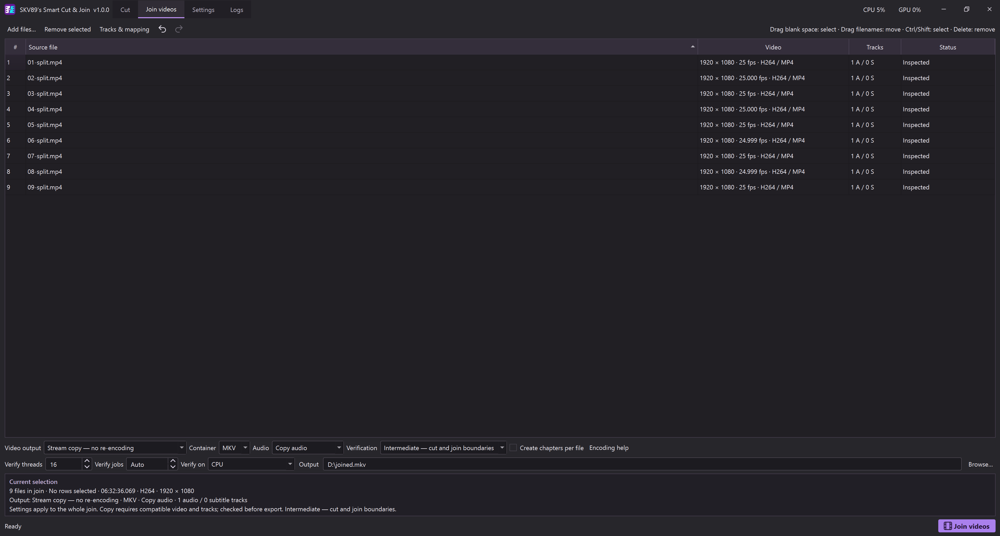

# SKV89's Smart Cut & Join

A focused Windows video cutter, splitter and joiner with smart rendering: keep the frames you want and copy as much of the original video as possible without encoding.

## Why I made it

I've been a long-time user and fan of [LosslessCut](https://github.com/mifi/lossless-cut). Its simple approach to cutting video is what I loved most about that app. But I kept running into file-compatibility problems and smart cut results I couldn't consistently rely on, especially when subitle tracks or multiple audio tracks were required to be preserved. Some features felt more complicated than I needed, while other controls I wanted were missing.

So I created SKV89’s Smart Cut & Join: my vision of the ideal video cutter and splitter, combining smart rendering with a simpler, more focused workflow. My goal was to pair the speed of LosslessCut with precise cuts and clear control over audio and subtitle tracks. Built-in repairs for known cut-boundary problems, automatic fallbacks where supported, and optional output verification help make exports more reliable, features that LosslessCut lacked - all with fewer decisions between opening a video and saving the parts you want, with no sacrifice to speed.

## Screenshots

### Cut and smart rendering

### Join compatible files without encoding

## What you can do

- **Cut, split and merge.** Keep selected clips or remove unwanted sections. Export clips separately or combine them into one video.
- **Copy most video without encoding.** Smart cut encodes only the boundary regions that need new frames, using supported CPU or NVIDIA paths.
- **Choose a simple or flexible editing mode.** Chronologic order prevents overlaps and numbers segments automatically. Out-of-order mode allows rearrangement, overlap and repeated footage.
- **Navigate accurately.** Drag the playhead to scan the preview, step by frame or keyframe, zoom the timeline, and display an audio waveform.
- **Keep the tracks you want.** Select and reorder audio and subtitles, choose defaults, and preview tracks independently of export selections.
- **Queue separate jobs.** Save cuts, track selections, output names and export settings in each queue entry. Review per-job elapsed times and clear completed entries.
- **Join compatible files without encoding.** Arrange files and map their tracks. For incompatible video, explicitly choose a supported encoder instead.
- **Tune performance locally.** Optimization tests selected scenarios and saves qualified CPU, GPU and verification resource recommendations automatically.

## Get started

1. Download `SKV89-Smart-Cut-Join-v1.0.1-Windows-x64.zip` from [Releases](https://github.com/skv89/SKV89-Smart-Cut-Join/releases).
2. Extract the entire ZIP into a writable folder.
3. Run **SKV89's Smart Cut & Join.exe**. Keep its `runtime` and `licenses` folders beside it.
4. On first use, open **Settings > General > Install/update FFmpeg**, then select **Install FFmpeg**. This downloads the latest stable Full build directly from Gyan.dev and verifies its checksum. An existing compatible FFmpeg/FFprobe 9.0+ installation can also be used.
5. Open a video, set Start and End, review tracks and output settings, then select **Export**.

Windows x64 is required. Python does not need to be installed. The package includes the preview player and app libraries. FFmpeg and FFprobe are downloaded separately from Gyan.dev using the built-in installer; internet access is needed for that initial download. Once installed, normal editing and exporting work offline. NVIDIA encoding requires a compatible GPU and driver; CPU paths remain available for supported formats.

Settings, projects, history and caches live in the app's `data` folder. Move that folder with the app to retain your work. Automatic project saving is off initially; use **Save project** or enable it in Settings. Videos and optimization results stay local. Updating media tools is an explicit action.

### Updating from v1.0.0

Close the app, extract the new ZIP into a separate folder, and copy **only `SKV89's Smart Cut & Join.exe`** into your existing app folder, replacing the old EXE. Keep your existing `runtime`, `licenses` and `data` folders. No FFmpeg reinstallation is required for this update. The ZIP also includes refreshed documentation; copying it is optional.

For a first-time installation, extract the **entire ZIP** and keep its folders together.

## Cut and smart rendering

| Mode | What happens |
| --- | --- |
| **Smart cut** | Keeps the selected video-frame boundaries and source codec, copying the middle and encoding required edges. |
| **Keyframe copy** | Copies without encoding. Cuts may expand to safe keyframes; review the actual boundaries. |
| **Encode selected segments** | Encodes the complete selected video when smart rendering is unavailable for a supported source. |

Copied video is unchanged. Encoded edges are not lossless. Very short selections or long gaps between safe keyframes can require encoding most or all of a selection.

If irregular timestamps prevent reliable frame-number editing, the app switches to Time mode so you can still set Start and End. Unaffected ranges can still use smart cut. Selections containing repeated timestamps may require full-segment encoding to retain each distinct picture; supported repairs are recorded in the job details. A healthy next file restores your preferred frame display.

The app starts in **Default: Chronologic order**. Segments stay in source order and cannot overlap. **Out-of-order & overlaps allowed** enables custom order, duplicates and repeated footage. **Delete segments** removes marked gaps and exports the remainder chronologically.

Only one segment can be unfinished. Its dashed outline becomes solid when both boundaries are set or Enter confirms the displayed range. Finish or remove it before selecting another segment. White outlines distinguish selected completed segments.

Use **Output name** to accept the suggested suffix or enter a custom filename. Separate-file exports add unique names for later segments. Existing output conflicts are handled explicitly; source media is protected.

## Audio, subtitles and Join

**Tracks & defaults** controls which tracks are exported and their order. The first checked audio and subtitle tracks become the defaults. Changing the preview track does not change what is exported.

Supported subtitle paths include text subtitles, ASS/SSA, DVD/VobSub and PGS image subtitles. Image subtitles remain images; OCR is not required. Compatibility depends on the subtitle stream and destination container. Unsupported tracks require an explicit conversion or exclusion rather than being silently dropped.

Smart cut normally copies original audio packets. Because compressed audio has its own block boundaries, edge timing may differ from a video-frame boundary. Where offered, lossless PCM provides precise audio cuts in MKV or MOV.

In **Join videos**, reorder files, inspect track mappings and select stream copy for compatible inputs. Explicit encoding offers supported software and NVIDIA choices. Aspect-ratio controls preserve the source shape within the selected canvas. Undo/Redo covers file-list and mapping changes.

Software H.264/x264 and HEVC/x265 offer **Balanced** and **Quality** effort. Quality spends more encoding effort at the same quality target; the size and speed difference depends on the content. NVIDIA presets have separate controls.

## Analysis and output checks

**Export analysis** reads the source information needed to plan a Cut. **Fast — automatic fallback** is the initial default: it uses local analysis where supported and expands the scan when necessary. **Full analysis** builds a complete source index. These are planning choices, not output-verification levels.

**Output checks** inspect the exported file:

| Mode | Checks performed |
| --- | --- |
| **Light** | Packets, timing and track structure, without decoding video or audio. |
| **Intermediate** | Light checks plus video decoding around starts, ends, joins and known encoded/copied transitions. Overlapping windows are combined; unreliable seeking can require a reported full CPU video check. |
| **Full** | Decodes the complete final video and checks its audio, once per final file. |

A merged export has one final output to check; separate files each receive their own checks. Full output checking does not decode the entire original movie.

Cut initially uses Light output checks and Fast analysis. Save Cut defaults in **Settings > General**; changes made inside an Export dialog affect that job only. Join initially uses Intermediate checks.

When existing analysis reveals a concern that still needs your attention, the Export dialog can show a concise amber note. Successful automatic scan fallbacks and timestamp repairs remain ordinary job details. These notes add no file-loading scans or confirmation prompts and do not pause an unattended queue.

Video checking can use CPU or qualified NVIDIA decoding. NVIDIA verification is currently qualified for progressive SDR H.264 8-bit and HEVC 10-bit 4:2:0, up to 4K, on the RTX PRO 6000 Blackwell Workstation Edition with driver 616.92. Other configurations use CPU with an explanation. Reported corruption or count/timing failure is not cleared by a fallback. No check guarantees detection of every possible picture error.

## Batch queue

**Add to queue** saves a snapshot of the current job. Later editing or changes to defaults do not alter it. **Export Queue** reviews and runs pending jobs; it does not implicitly add the current edit.

Completed jobs remain available for review until removed or cleared. When no pending files remain, **Export** opens the current edit again. By default, closing the app discards the queue. Enable **Keep queue between app sessions** to retain it without automatically starting work.

Cancellation retains completed outputs. Retry only the unfinished files of a failed or interrupted job. Queue exports use new names and preserve existing files.

## Optimization

Optimization finishes one selected scenario before moving to the next. Quick, Extended and Performance search allow **up to 10, 30 and 60 active minutes per scenario**. They can finish sooner when further measurements are unlikely to change the recommendation.

Competitive settings receive repeated measurements. Results show mean and median time, variation, measured coverage and failures. A modest timing spread does not discard correctly verified results. Encoder effort and output-check policies are recorded so comparisons remain meaningful.

Qualified recommendations are saved and used automatically. Stop and Resume retain completed work. A failed or inconclusive rerun does not erase an earlier valid recommendation, and a newer manual edit is preserved. Balanced and Quality software encoding have separate resource recommendations. Results reflect the measured workloads, not a universal optimum for all videos.

## Compatibility limits

- Cut outputs are MKV, MP4 or MOV, with codec/track compatibility checked for the chosen container.
- Smart cut covers qualified progressive SDR codecs, including common H.264/HEVC paths and supported legacy formats. It is not available for every decoder-readable input.
- HDR/Dolby Vision and interlaced boundary encoding are not currently supported. Full-segment encoding is not a universal workaround for these sources.
- DVB/teletext subtitles, unsupported bitmap control programs and some legacy audio/container combinations require explicit conversion or exclusion.
- CPU and NVIDIA support depends on the source format and available runtime. The app explains unsupported combinations before proceeding where possible.

See the package's **README.txt** for detailed controls, supported paths and limitations.

## License and acknowledgments

The application is free to use under the included [application license](LICENSE.txt). Application source is private. [Third-party components](THIRD_PARTY.md) retain their own licenses and attribution requirements. SKV89's Smart Cut & Join is independent of those projects.
